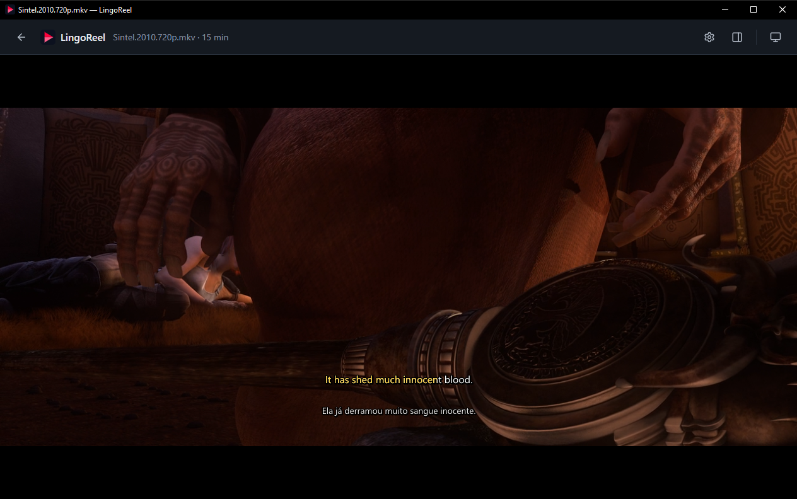
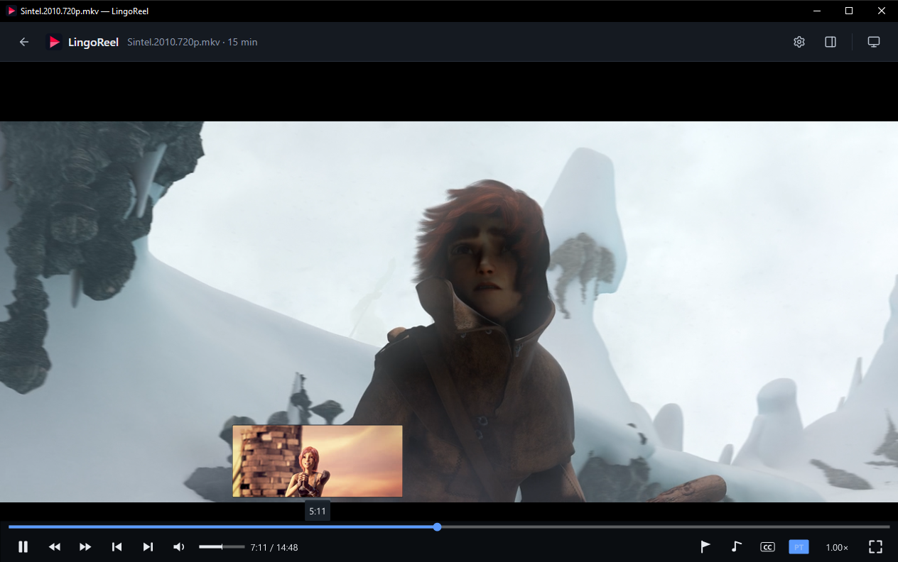
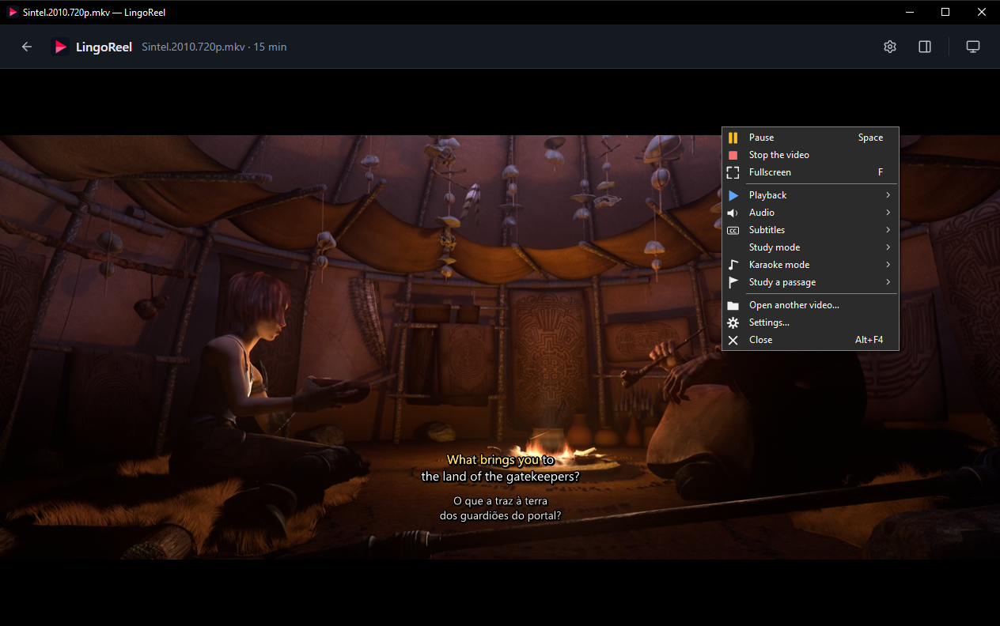
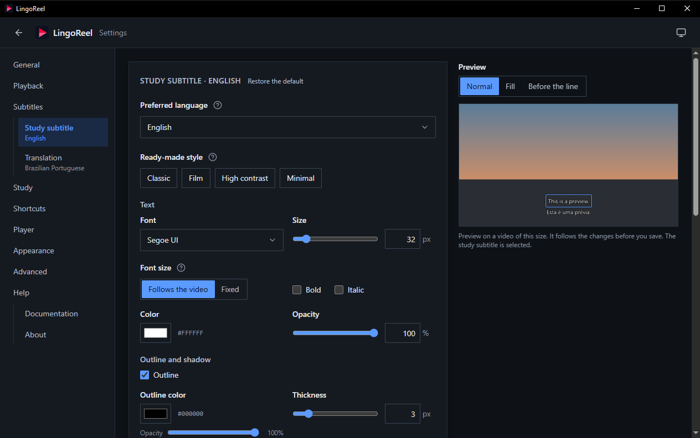
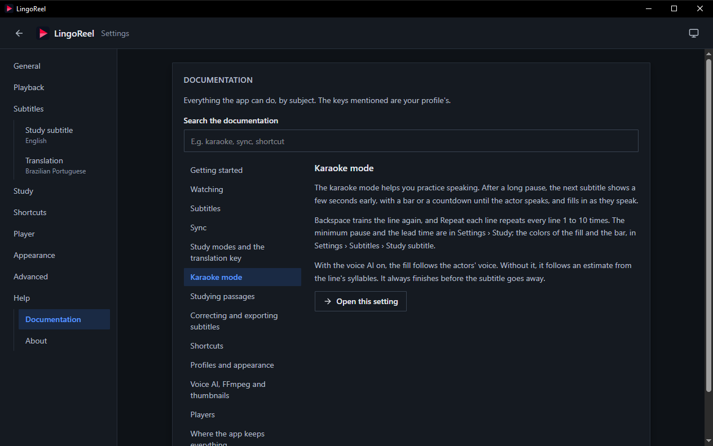
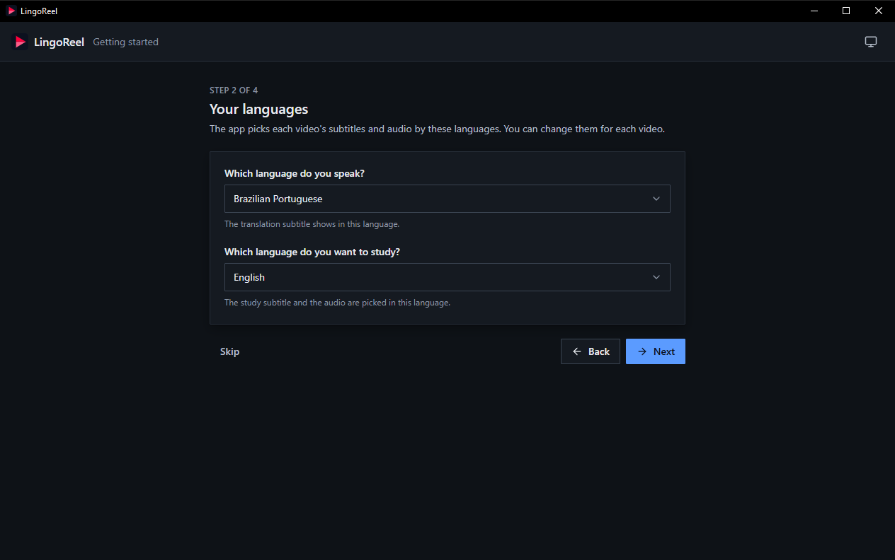

  

<h1 align="center">LingoReel</h1>

  <strong>Learn a language with the movies and series you already love.</strong> 
  Two synchronized subtitles over your video, a karaoke mode that follows the actors' voice, and passages to practice
  until they stick.

  
  
  
  

  

LingoReel opens your video and draws two subtitles over it: one in the language you are learning and its
translation, which can stay on screen or show up only when you ask for it. Everything runs on your computer, for free.

> **Beta:** versions stay at `0.x` for a while. Everything below already works, and the app keeps getting better.

## Highlights

- **Two subtitles at once**, the study line and its translation, each with its own sync. The translation comes and goes
  with the line it translates.
- **Translation on demand:** hide it, show it, or hold a key to peek, and learn to understand without it.
- **Karaoke mode:** the next line shows up ahead of time and fills in as the actor speaks, so you can speak along. A
  speech model inside the app follows the voice, even through music and sound effects.
- **Passages:** mark where a scene begins and ends, and it repeats until you leave it. Your passages, speed and sync come
  back the next time you open the video.
- **The best subtitle first:** subtitles inside the video or in any folder, judged by what they hold, not by their names.
  A video with no subtitle of its own is heard to find the file that fits it.
- **Fix a line right on the video:** double-click it while paused, correct it, undo and redo, and export the result as
  `.srt` or `.ass`.
- **Stills on the seek bar**, as video sites do, kept in the app's own folder.
- **Everything is yours to change:** shortcuts, colors, fonts, sizes, the bar, the menus, per profile.

<table>
  <tr>
    <td width="50%"></td>
    <td width="50%"></td>
  </tr>
  <tr>
    <td align="center">A still of any moment on the seek bar</td>
    <td align="center">Everything one right click away</td>
  </tr>
  <tr>
    <td width="50%"></td>
    <td width="50%"></td>
  </tr>
  <tr>
    <td align="center">Every look with a live preview</td>
    <td align="center">The whole guide inside the app</td>
  </tr>
</table>

## Getting started

1. Download `lingoreel.exe` from the [releases](../../releases). It is a single portable file: no installation.
2. Open it. A short setup assistant asks the language you speak, the one you study, how you want to study, and which
   player to use. Each step can be skipped.
3. Drop a video on the window, or open one with the app from the Windows menu.

Settings › Help › Documentation explains everything the app can do, with your own shortcuts.

  

## Features

**Watching**
- Plays inside the app's window with VLC, or in PotPlayer's own window. You choose your favorite player, and the app
  offers to install one (with winget, from its authors) if none is found.
- Its own control bar over the video: seek with stills, frame by frame, speed, volume up to 200% (on VLC), fullscreen,
  always on top, and menus for the subtitles, the karaoke mode and the passages.
- Windowed, fullscreen, several monitors and display scaling from 100% to 200%.

**Subtitles**
- Reads the subtitles inside `.mkv` files without ever changing the file, and `.srt`, `.ass`, `.ssa` and `.vtt` files
  from any folder.
- Tells a subtitle's language, and whether it is for the hearing impaired or forced, from its text.
- Sync each line on its own with a key; switch subtitles and audio while the video plays; watch with no subtitle at all.

**Studying**
- Three study modes: both subtitles, translation on demand, and translation always visible.
- Repeat the line, the phrase, or the last 3, 5 or 10 seconds; a precision step and frame stepping for the hard parts.
- Karaoke mode with a bar or a countdown before each line, and a fill that follows the voice.
- Saved passages per video, and the video resumes where you left off.

**Correcting**
- Correct a line in place while paused, adjust its timing, undo and redo. The original text is never lost.
- One project per video in the app's own folder, known by the video's content, so renaming or moving the video keeps it.
- Export the corrected, synchronized subtitle as `.srt` or `.ass` for any player.

**Your way**
- Profiles, each with its languages, shortcuts and looks. Themes (light, dark, or Windows'), the app's accent color,
  font and text size.
- The app speaks American English and Brazilian Portuguese, and switches at once.
- Friendly messages that say what went wrong and what to do, daily logs and a diagnostics screen.

## Default shortcuts

| Key | Action | Key | Action |
|---|---|---|---|
| `Space` | Play or pause | `Right Alt` | Show or hide the translation |
| `←` / `→` | Back or forward 5 s | `Backspace` | Replay the line |
| `Shift` + `←` / `→` | Back or forward 10 s | `F9` | Repeat the phrase |
| `Ctrl` + `←` / `→` | Back or forward 30 s | `3` / `5` / `0` | Repeat the last 3, 5 or 10 s |
| `Alt` + `←` / `→` | Precision step | `Ctrl` + `F9` / `F10` | Mark a passage's start / end |
| `,` / `.` | Frame back / forward | `Shift` + `,` / `.` | Sync the study line |
| `↑` / `↓` | Volume | `Ctrl` + `,` / `.` | Sync the translation |
| `Ctrl` + `↑` / `↓` / `0` | Speed down / up / normal | `Ctrl` + `Z` / `Y` | Undo / redo a correction |
| `F` / `Esc` | Fullscreen / leave it | `M` | Mute |

Every shortcut can be changed in Settings › Shortcuts, per profile.

## Requirements

- Windows 10 or 11, 64-bit.
- [VLC](https://www.videolan.org/vlc/) or [PotPlayer](https://potplayer.tv/), both free. The app offers to install one.
- [FFmpeg](https://ffmpeg.org/), free and optional: with it, the app hears a video to choose its subtitle, follows the
  voice a little ahead of the film, and shows stills on the seek bar.
- Microsoft WebView2, which Windows 11 and an up-to-date Windows 10 already have. A computer without it is offered the
  download from Microsoft.

On a weak computer the voice AI starts off, and can be turned on at your own risk.

## Privacy

Everything stays on your computer. The app sends nothing over the internet, keeps what it saves in
`%APPDATA%\LingoReel`, and never writes next to your videos. Its logs leave out the subtitles' text.

## Languages

The interface speaks American English and Brazilian Portuguese, and follows the Windows display language until you pick
one. Every text comes from a catalog per language, so adding a language takes no code: see
[Translating](docs/translating.md).

## Building from source

Requirements: Windows 10/11 64-bit, [Go](https://go.dev/) 1.26+, the [Wails CLI](https://wails.io/) v2.16,
[Node.js](https://nodejs.org/) with npm, git and PowerShell 5.1+. The check also runs
[staticcheck](https://staticcheck.dev/) (`go install honnef.co/go/tools/cmd/staticcheck@v0.8.1`), and `go test -race`
needs a `gcc` on the `PATH`.

| Command | What it does |
|---|---|
| `powershell -NoProfile -ExecutionPolicy Bypass -File scripts\check.ps1` | Formatting, static analysis and tests (`-Full` adds the race detector and the real players) |
| `powershell -NoProfile -ExecutionPolicy Bypass -File scripts\build.ps1` | Builds the executables into `build\bin` |
| `powershell -NoProfile -ExecutionPolicy Bypass -File scripts\dev.ps1` | Opens the app in development mode (reloads when the code changes) |
| `powershell -NoProfile -ExecutionPolicy Bypass -File scripts\package.ps1` | Builds a portable zip into `build\dist` (after the build) |

Versions follow [Semantic Versioning](https://semver.org/); see the [changelog](CHANGELOG.md).

## Contributing

Contributions are welcome! Open an issue to talk about an idea, or send a pull request. Before sending it, run
`scripts\check.ps1`: it must pass without errors. The interface follows [Prettier](https://prettier.io/): run
`npm run format` in the `frontend` folder.

- Another player? Every player is a plugin that follows the same contract: see [Player plugins](docs/player-plugins.md).
- The app in your language? See [Translating](docs/translating.md).

## License and credits

LingoReel is distributed under the [MIT license](LICENSE): you may use, copy, modify and distribute it, in whole
or in part, commercial projects included, as long as you keep the copyright notice and the license text.

The app carries third-party code under permissive licenses (MIT, BSD, ISC and Apache-2.0): Go, Wails, React, a few
small libraries, and the [Silero VAD](https://github.com/snakers4/silero-vad) speech model (MIT), computed inside the
app. Their notices are in the app, in Settings › Help › About. VLC, PotPlayer and FFmpeg are not shipped with it: the
app uses the copies on your computer.

The screenshots show [Sintel](https://durian.blender.org/), © copyright Blender Foundation | durian.blender.org,
under the [Creative Commons Attribution 3.0](https://creativecommons.org/licenses/by/3.0/) license.

If this project is useful to you, **please give credit** by mentioning LingoReel and its author, Edie Johnny,
with a link to the repository. The license does not require it, but it is a kind gesture that helps the project go on.
